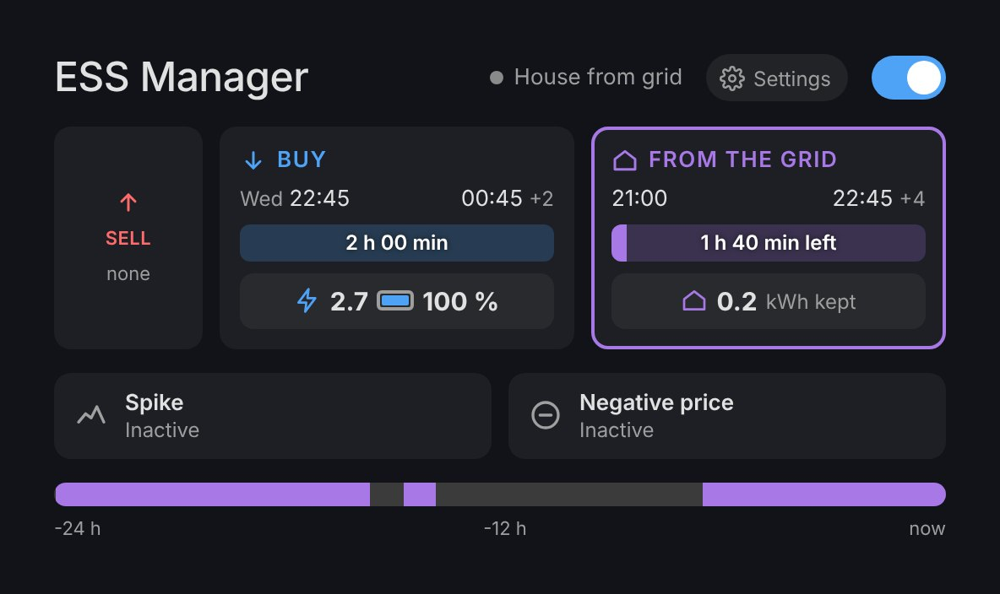
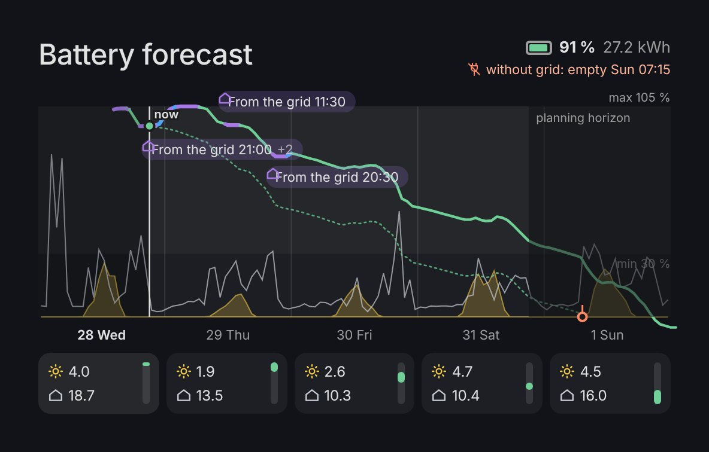
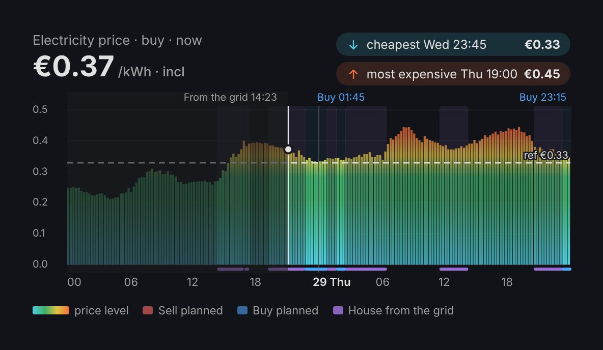
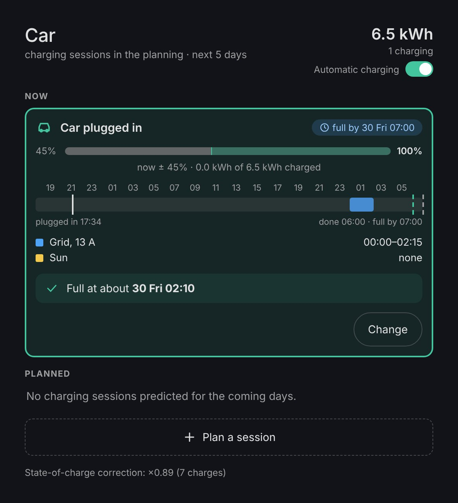
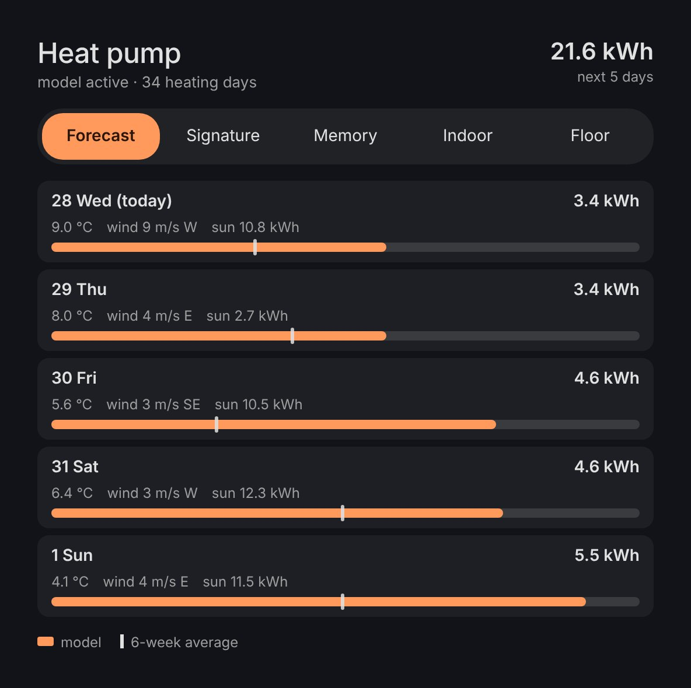
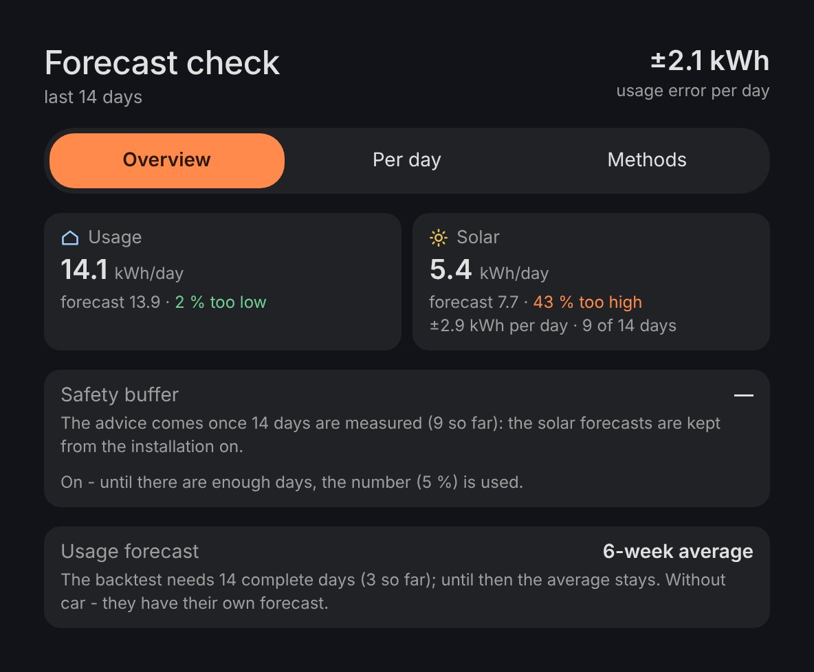
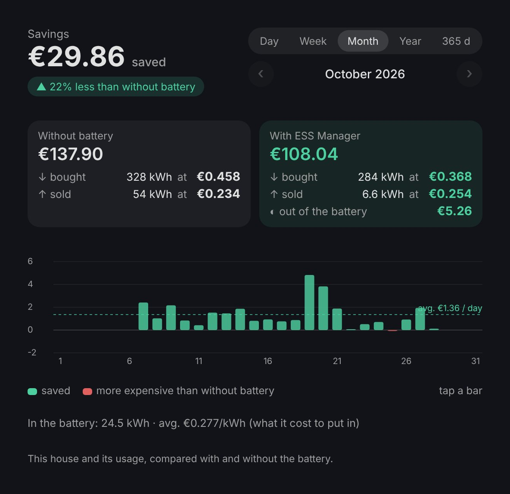

# ESS Manager

[](https://github.com/MisterX-RC/ESS-manager-HA/actions/workflows/validate.yaml)
[](https://github.com/MisterX-RC/ESS-manager-HA/releases)
[](LICENSE)

A Home Assistant custom integration that plans and steers a home battery on
dynamic (quarter-hour) electricity prices, a solar forecast and a learned
household usage forecast - and plans the electric car and the heat pump
around the same prices.

**What it does**

- **Battery planning** - every minute a five-day forecast of the battery
  level, and plans for when to charge (in the cheapest quarters, each part
  before it's needed), when to sell (in the priciest), price spikes,
  negative prices, a periodic full charge for cell balancing, and taking
  the house from the grid at low prices instead of out of the battery.
- **Control** - it can send the grid / inverter setpoint itself (for
  example a Victron GX's ESS setpoint), or leave that to your own
  automation that follows its Status sensor. With control switched off the
  status card sets the setpoint by hand.
- **Prices** - Nord Pool day-ahead prices, optionally including taxes
  (entered by hand or learned from your supplier's price sensor) and a
  grid transport tariff. A reference price from the last week keeps the
  plans from buying at a dear moment while later prices aren't known yet.
- **Electric car** - a Victron EV charging station or a myenergi zappi:
  charging sessions "full by" a time (in the cheapest quarters), as soon as
  possible, slowly or on the sun, predicted from when the car is usually
  plugged in, with phone notifications that ask the state of charge. Or
  charge by hand from the card.
- **Heat pump** - a model of what the heat pump uses per day and per hour
  (from the weather, the sun and the wind), a learned thermostat, steering
  of the day / night temperature and buffering heat at cheap moments, and
  floor heating control (return setpoint) for a Qube heat pump.
- **Insight** - a forecast check (how good the usage and solar forecasts
  were, with a Safety buffer advice), what the battery saved against the
  same house without one, problem notices and diagnostics.
- **Seven dashboard cards**, drawn by the integration itself - nothing else
  to install.

It started as a hand-written template sensor and was rebuilt as a
configurable integration, installable via HACS.

**Contents:**
[Screenshots](#screenshots) · [Requirements](#requirements) ·
[Installation](#installation) · [Getting started](#getting-started) ·
[Documentation](#documentation)

## Screenshots

The integration's own dashboard cards - search for **ESS Manager** in the
"Add card" picker. See [Dashboard cards](docs/cards.md) for their options. *(Shown
with Home Assistant's default dark theme and demo data; with a theme they
take its colours.)*

**Status** - the planned charge and sale (and the house from the grid)
side by side with their progress; a block that's running gets an outline.
Below: the spike and negative price plans and a timeline of the last 24
hours. Top right: the control toggle and a Settings button.



**Battery forecast** - five whole days: left of "now" what happened, right
of it the expected battery level with the planned actions in their colour,
the solar and usage forecast, and dotted the level without any plan. Below
the chart a tile per day.



**Prices** - today's and tomorrow's prices coloured from cheap to
expensive, the planned moments in full colour, the reference price as a
dashed line. Top: the price now and the cheapest / most expensive moment
still to come.



**Electric car** - the plugged-in car with its plan (here "full by"
Friday 07:00, waiting for the next day's prices), and the planned or
predicted sessions of the coming days.



**Heat pump** - the forecast per day from the weather, and in the other
tabs the energy signature, what the model has learned, the indoor model
and floor control.



**Forecast check** - how far the usage and solar forecasts were off, the
Safety buffer advice and which usage forecast is in use.



**Savings** - what the battery saved against the same house without one,
per day, week, month or year.



## Requirements

- Home Assistant with **HACS**.
- A **battery state of charge** sensor (0-100 %).
- A **quarter-hour price** sensor with `today` / `tomorrow` lists, like the
  Nordpool integration gives.
- A **solar forecast**: Solcast or Helios Forecast (several roof planes are
  added up).
- A **household usage forecast**: nothing extra when the Energy dashboard is
  set up - ESS Manager learns it from its statistics. A cumulative energy
  sensor works too.
- *Optional*: the grid / inverter setpoint entity, a battery power sensor,
  cell and pack voltages for full-charge balancing, a Victron EV charging
  station or myenergi zappi, a heat pump with an energy meter.

The full list, with the exact formats: [Setup](docs/setup.md#requirements).

## Installation

[](https://my.home-assistant.io/redirect/hacs_repository/?owner=MisterX-RC&repository=ESS-manager-HA&category=integration)

1. In HACS add `https://github.com/MisterX-RC/ESS-manager-HA` as a custom
   repository (type **Integration**), or use the button above.
2. Download **ESS Manager** and restart Home Assistant.
3. Settings -> Devices & services -> **Add integration** -> "ESS Manager".

Updates show up in HACS like any other integration. A manual install is
described in [Setup](docs/setup.md#manual).

## Getting started

The setup wizard asks for the sensors, the battery (capacity, speeds,
min/max SOC), which price plans you want and whether ESS Manager sends the
setpoint itself or only gives a **Status** sensor for your own automation.
The electric car and the heat pump are switched on on the price plans page.
Everything can be changed later in **Configure**. Day-to-day values
(minimum SOC, Safety buffer, charge speed, ...) are `number` entities on the
device page - the status card's **Settings** button opens it.

Then add the cards: edit a dashboard -> **Add card** -> search for
**ESS Manager**. Each card only needs the installation's Status sensor.

## Documentation

How it all works, in detail:

| Page | About |
|---|---|
| [Battery planning](docs/battery-planning.md) | the charge, sell, spike, negative price and grid plans, the household usage forecast, the forecast check and full-charge balancing |
| [Prices](docs/prices.md) | the grid transport tariff and prices including taxes |
| [Electric car](docs/electric-car.md) | charging sessions, the Victron EV charging station, the myenergi zappi, phone questions and charging by hand |
| [Heat pump](docs/heat-pump.md) | the day and hour model, the learned thermostat, temperature steering and floor control |
| [Setup](docs/setup.md) | requirements, installation, every setting in Configure and the tunable numbers |
| [Control](docs/control.md) | your own automation or direct control of the setpoint, problem notices and diagnostics |
| [Dashboard cards](docs/cards.md) | the seven cards and their options |

## Where it came from

ESS Manager started as a hand-written Home Assistant template sensor for one
Victron system and was rebuilt as this integration so it can be installed
anywhere: every entity is configurable, the household usage forecast is
calculated internally from the Energy dashboard, and the plans survive a
restart. What changed per version is in [CHANGELOG.md](CHANGELOG.md).

## Repository layout

```
custom_components/ess_manager/   the integration itself (frontend/ = its dashboard cards)
docs/                            the detailed documentation (images/ = screenshots)
dashboard/                       the old dashboard cards as YAML + example automation
tools/build_cards.py             builds frontend/ess-manager-cards.js from tools/cards_template.js
tests/                           standalone tests (no Home Assistant needed)
tests/ha/                        Home Assistant tests (pytest tests/ha)
.github/workflows/validate.yaml  HACS + hassfest validation on every push
```

## Versioning

Versions are **year.month.release**, like Home Assistant's own (`2026.11.0`,
`2026.11.1`, ...). Every version gets a GitHub Release tagged `v<version>`
with its `CHANGELOG.md` section as notes, so HACS shows what changed.

## License

MIT - see [LICENSE](LICENSE).
